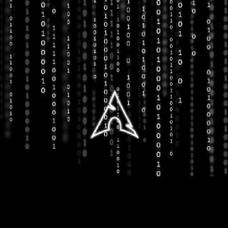
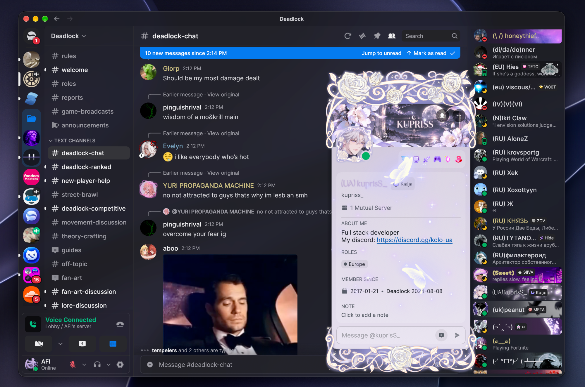

# NuSerein

<p align="center">
  
</p>

<p align="center">
  <a href="https://github.com/MCShotty/NuSerein">
    
  </a>
</p>

The preview above is a historical Serein screenshot; the interface and icon have since changed.

<p align="center">
  <strong>A lightweight, native Discord desktop client written in Rust, powered by egui and wgpu.</strong>
</p>

NuSerein is MCShotty’s fork of [Serein](https://github.com/ViceVerse-cz/Serein). Existing application data and installation identifiers remain compatible.

<h3 align="center">
  <a href="https://discord.gg/UqTDGCENaN">💬 Join our Discord server for updates</a>
</h3>

<p align="center">
  <a href="#downloads--installation"><strong>📦 Downloads</strong></a> &nbsp;•&nbsp;
  <a href="#highlights"><strong>⚡ Highlights</strong></a> &nbsp;•&nbsp;
  <a href="#feature-showcase"><strong>✨ Showcase</strong></a> &nbsp;•&nbsp;
  <a href="#measured-performance-vs-official-discord"><strong>📊 Benchmarks</strong></a> &nbsp;•&nbsp;
  <a href="#quick-start"><strong>🛠️ Quick Start</strong></a> &nbsp;•&nbsp;
  <a href="#feature-matrix"><strong>📋 Features</strong></a> &nbsp;•&nbsp;
  <a href="#architecture-overview"><strong>🏗️ Architecture</strong></a>
</p>

<p align="center">
  <a href="https://discord.gg/UqTDGCENaN"></a>
  <a href="https://github.com/MCShotty/NuSerein/releases"></a>
  <a href="Cargo.toml"></a>
  <a href="crates/ui"></a>
  <a href="docs/platform-support.md"></a>
  <a href="LICENSE-MIT"></a>
</p>

---

> [!WARNING]
> **Unofficial and not endorsed by Discord.**
> NuSerein communicates directly with Discord's public gateway and REST endpoints for your existing account. Automating normal accounts outside the official OAuth2/bot API violates Discord's Terms of Service and carries risk of account termination. Technical interoperability does not imply platform approval. Review the [compatibility matrix](docs/discord-compatibility.md) and [authentication guide](docs/authentication.md) before use.

---

## Downloads & Installation

NuSerein releases, when published, appear on the [fork’s releases page](https://github.com/MCShotty/NuSerein/releases).

The following distribution instructions describe **upstream Serein builds**, not NuSerein builds. Upstream packages and updates do not contain the fork’s changes; use them only if you intend to install upstream Serein.

| Platform | Format | Architectures | Details |
|---|---|---|---|
| **Windows** | `-Setup.exe`, `.zip` | `x86_64`, `aarch64` | Per-user NSIS installer (recommended) or standalone portable archive |
| **macOS** | Homebrew Cask, `.zip`, Nix flake | Apple Silicon (`aarch64`) | Signed and notarized `.app` bundle; the Nix build is unsigned |
| **Linux** | Flatpak (recommended), Repositories (`apt`, `dnf`, `zypper`, `pacman`), Gentoo ebuild, Nix flake, `.AppImage` | `x86_64` | Flatpak with automatic updates; signed package repositories; portable AppImage |

---

<details open>
<summary><h3>🐧 Linux (Flatpak, Repositories, Gentoo, Nix, AppImage)</h3></summary>

#### 1. Flatpak (Recommended)

Flatpak is the recommended distribution format for Linux, featuring sandbox isolation, bundled GNOME/WebKit runtimes, and automatic background updates.

- **One-Click Repository Install (Automatic Updates)**:
  ```sh
  flatpak install --user https://viceverse-cz.github.io/Serein/flatpak/serein.flatpakref
  ```
  Once installed, your desktop software store (GNOME Software, KDE Discover) or `flatpak update` will automatically discover and install updates.

- **Standalone Offline Bundle**:
  Download `Serein-linux.flatpak` from [Releases](https://github.com/ViceVerse-cz/Serein/releases):
  ```sh
  flatpak install --user ./Serein-linux.flatpak
  flatpak run cz.viceverse.serein
  ```

See [Flatpak guide](packaging/flatpak/README.md) for sandbox permissions and source build details.

#### 2. Native Package Repositories (apt, dnf, zypper, pacman)

Configure the signed package repository for your distribution with one command:
```sh
curl -fsSL https://viceverse-cz.github.io/Serein/setup.sh | sh
```
The script detects your distribution (Ubuntu/Debian, Fedora, openSUSE, Arch Linux), cryptographically verifies the GPG signing key, and configures the repository with an option to install immediately.

After setup, manage Serein with your native package manager:
```sh
# Ubuntu / Debian: sudo apt install serein
# Fedora:          sudo dnf install serein
# openSUSE:        sudo zypper install serein
# Arch Linux:      sudo pacman -S serein
```
Your normal system updates (`apt upgrade`, `dnf upgrade`, `zypper update`, `pacman -Syu`) will keep Serein updated. See [Signed package repositories](packaging/repositories/README.md) for manual GPG verification steps.

#### 3. Gentoo (source or binary)

Gentoo users can install Serein from the [vitaly-zdanevich-overlay](https://github.com/vitaly-zdanevich/gentoo-overlay) overlay. It provides a source ebuild ([net-im/serein](https://github.com/vitaly-zdanevich/gentoo-overlay/tree/main/net-im/serein)) and a prebuilt amd64 ebuild ([net-im/serein-bin](https://github.com/vitaly-zdanevich/gentoo-overlay/tree/main/net-im/serein-bin)).

```sh
sudo eselect repository add vitaly-zdanevich-overlay git https://github.com/vitaly-zdanevich/gentoo-overlay.git
sudo emaint sync -r vitaly-zdanevich-overlay
echo 'net-im/serein ~amd64' | sudo tee /etc/portage/package.accept_keywords/serein
sudo emerge --ask net-im/serein
```

Use `net-im/serein-bin` in the keyword file and emerge command to install the prebuilt binary instead. The source ebuild requires Rust 1.98.1 or newer. The binary ebuild targets amd64 systems with glibc 2.43 or newer. The two ebuilds install the same files, so choose one.

#### 4. Nix (flake)

Nix installs are updated through Nix, not the in-app updater. On macOS the build produces an unsigned, non-notarized `Serein.app`. See the [Nix package guide](nix/README.md) for the development shell and details.

The repository flake builds NuSerein from source for `x86_64-linux` and `aarch64-darwin`:

```sh
nix run github:MCShotty/NuSerein#serein
nix profile install github:MCShotty/NuSerein#serein
```

Or declaring it in the flake

Both modules below take `inputs` as an argument, so your flake must pass it through `specialArgs` (NixOS) and `extraSpecialArgs` (Home Manager). Without this, importing the modules fails with a missing `inputs` argument.

`flake.nix`
```nix
{
    inputs = {
        nixpkgs.url = "github:NixOS/nixpkgs/nixos-unstable";
        home-manager = {
            url = "github:nix-community/home-manager";
            inputs.nixpkgs.follows = "nixpkgs";
        };
        serein = {
            url = "github:MCShotty/NuSerein";
            inputs.nixpkgs.follows = "nixpkgs";
        };
    };

    outputs = { nixpkgs, home-manager, ... }@inputs: {
        # NixOS
        nixosConfigurations.hostname = nixpkgs.lib.nixosSystem {
            system = "x86_64-linux";
            specialArgs = { inherit inputs; };
            modules = [ ./configuration.nix ];
        };

        # Standalone Home Manager
        homeConfigurations.username = home-manager.lib.homeManagerConfiguration {
            pkgs = nixpkgs.legacyPackages.x86_64-linux;
            extraSpecialArgs = { inherit inputs; };
            modules = [ ./home-manager.nix ];
        };
    };
}
```

If you use Home Manager as a NixOS module instead, pass `inputs` through its own option:

```nix
{
    nixosConfigurations.hostname = nixpkgs.lib.nixosSystem {
        system = "x86_64-linux";
        specialArgs = { inherit inputs; };
        modules = [
            ./configuration.nix
            home-manager.nixosModules.home-manager
            {
                home-manager.extraSpecialArgs = { inherit inputs; };
                home-manager.users.username = import ./home-manager.nix;
            }
        ];
    };
}
```

`configuration.nix`
```nix
{
    inputs,
    pkgs,
    ...
}: {
    environment.systemPackages = [
        inputs.serein.packages.${pkgs.stdenv.hostPlatform.system}.default
    ];
}
```

`home-manager.nix`
```nix
{
    inputs,
    pkgs,
    ...
}: {
    home.packages = [
        inputs.serein.packages.${pkgs.stdenv.hostPlatform.system}.default
    ];
}
```

#### 5. Standalone AppImage (Portable)

Download `serein-<version>-Linux-X64.AppImage` from [Releases](https://github.com/ViceVerse-cz/Serein/releases), make it executable, and run:
```sh
chmod +x ./serein-*-Linux-X64.AppImage
./serein-*-Linux-X64.AppImage
```
Keep the AppImage in a writable directory to receive in-app updates via **Settings → Updates**. Note that the AppImage uses host GTK4 and WebKitGTK 6.0 libraries; see [AppImage setup and runtime dependencies](packaging/appimage/README.md) for host requirements.

</details>

<details>
<summary><h3>🪟 Windows (Installer, Portable)</h3></summary>

#### 1. Setup Installer (Recommended)
Download the `Windows-X64-Setup.exe` or `Windows-ARM64-Setup.exe` asset for your system from [Releases](https://github.com/ViceVerse-cz/Serein/releases) and run it:
- Installs per-user to `%LOCALAPPDATA%\Programs\Serein` without requiring administrator/UAC elevation.
- Automatically registers Start Menu shortcuts and configures AppUserModelID (`cz.viceverse.serein`) for native Windows toast notifications.
- Registers in Windows Settings (Installed Apps / Add or Remove Programs) with full uninstall support.
- After installing this version, in-app self-updates automatically synchronize the registered version.

**Upgrading an earlier Windows build, including the encoder-only FFmpeg build:** close Serein and
run the new matching `-Setup.exe` once over the existing installation. Its old
in-app updater cannot install the new codec DLLs. Portable users should extract
the complete new archive into a new folder and launch it there. Settings and
credentials remain in their existing per-user storage. See the
[Windows migration guide](packaging/windows/README.md) for details.

#### 2. Portable Archive
Extract the complete `Windows-X64-media-v5.zip` or `Windows-ARM64-media-v5.zip` asset for your system into its final folder and launch `serein.exe`. To enable native desktop notifications:
```powershell
powershell -File .\install-notifications.ps1
```
Run the script from the extracted folder beside `serein.exe`. If PowerShell's `RemoteSigned` policy blocks the downloaded script, review it and run `Unblock-File -LiteralPath .\install-notifications.ps1` in that folder before retrying. The Windows installer registers the shortcut automatically, so installed builds do not need this script.

Before moving or deleting the portable folder, remove its notification shortcut with `powershell -File .\install-notifications.ps1 -Remove`. The portable archive does not include `setup.ps1`; use the matching `-Setup.exe` asset for an installed build.

</details>

<details>
<summary><h3>🍎 macOS (Homebrew Cask, Standalone .app)</h3></summary>

#### Homebrew Cask
```sh
brew tap ViceVerse-cz/serein
brew install --cask serein
```
The cask lives in the small [`homebrew-serein`](https://github.com/ViceVerse-cz/homebrew-serein) tap, so installing does not clone this repository. If you tapped the old URL, run `brew untap ViceVerse-cz/serein` first and tap again.

#### Standalone Bundle
Download `serein-<version>-macOS-ARM64.zip` from [Releases](https://github.com/ViceVerse-cz/Serein/releases), unzip, and drag `Serein.app` to your `/Applications` folder.

</details>

---

## Highlights

- ⚡ **Pure Native Performance:** Built with pure Rust, `egui`, and `wgpu`. Immediate-mode rendering with minimal idle CPU, low memory footprint, and instantaneous launch times—zero Electron, Node.js, or web runtime overhead.
- 🌐 **Direct Gateway & REST Transports:** Direct connection to Discord's official endpoints with active rate-limiting cooldowns, heartbeat handling, reconnect/resume loops, and partial payload patching.
- 🔒 **Secure OS Credential Storage:** Session tokens use your operating system's secure vault by default (macOS Keychain, Windows Credential Manager, or Linux Secret Service). Settings › Storage offers an explicit, unencrypted plaintext fallback when the keyring does not work.
- 🛡️ **Ephemeral Authentication Webview:** Sign-in uses Discord's official hosted login page inside a temporary native webview (WKWebView, WebView2, or WebKitGTK) supporting email/password, QR login, and MFA. An origin-checked handoff secures the session credential and immediately terminates the webview.
- 💾 **Bounded Local Persistence:** Recent chat history, drafts, image previews, settings, and diagnostics are stored in an account-isolated, bounded local SQLite database. All local data is strictly cleared upon explicit logout.
- 🎙️ **Voice Calls, Video & Screen Sharing:** Complete native voice engine with 1-to-1 and group DM calls, server voice channels, push-to-talk, Sonora AEC3 acoustic echo cancellation, RNNoise noise suppression, Opus codec, and DAVE v1 end-to-end encryption. Includes native screen capture (macOS ScreenCaptureKit, Windows Graphics Capture, Linux portal/PipeWire; FFmpeg NVENC/AMD AMF/Intel Quick Sync/VideoToolbox encoding; H.264 software fallback and hardware H.265/AV1 choices; hardware/live codec compatibility remains unverified) and incoming stream & camera video playback with hardware-accelerated decoding (VideoToolbox, VA-API, DirectX).
- 🧵 **Forum Channels & Active Threads:** Browse forum channels, view posts sorted by recent activity, read message threads with unread indicators, and create new forum posts directly in-app.
- ⚙️ **Server Administration Suite:** Full server management interface including Server Profiles (banners, icons, traits, descriptions), custom sticker management, role editor with fine-grained permission matrix, paginated audit logs with action filters, invite manager with revocation, integrations and webhooks, and member moderation.
- ✨ **GIF & Twemoji Picker:** Instant KLIPY GIF search with favorites and one-click sending, full Twemoji picker with search and quick-reactions, plus custom guild emojis.
- 📎 **Multi-Attachment Batch Uploads:** Composer staging tray supporting multiple files of any type (PDF, ZIP, 3D STL, videos, audio, images) with file-type badges, thumbnails, size indicators, individual removal, and progress tracking.
- 👤 **Native Profile Customization:** In-app profile editor for global display names, bios / about me, pronouns, and custom accent colors with real-time live preview cards.
- 🎨 **Extensions & Theme Shop:** Git-backed plugin engine and community theme shop with preview cards, color preset toggles, permission verification, and a built-in deleted-message retention protector.
- 🎬 **Rich Media & Video Player:** Inline video playback for attachments and Discord-proxied clips, an isolated in-app YouTube player, interactive seekable voice message waveforms, right-click media save/copy context menus, and full-resolution image viewer modals.
- ⌨️ **Keybinds & Shortcuts:** Built-in keybind reference sheet styled with raised keycaps, quick edit (`Up`), quick delete (`Backspace`), and intuitive keyboard navigation.
- 🎮 **Rich Presence & Game Detection:** Built-in Discord IPC and WebSocket RPC servers, plus executable-based detection of running games, showing live game activities in member rosters, DM lists, and user profiles, with opt-in system tray integration.

---

## Feature Showcase

These screenshots are historical Serein examples and have not been refreshed for NuSerein.

| Voice Calls & Live Screen Sharing | User Settings & Profile Customizer |
| :---: | :---: |
|  |  |
| **Server Administration & Profiles** | **Threads & Forum Channels** |
|  |  |
| **Multi-File Attachment Uploads** | **GIFs & Twemoji Picker** |
|  |  |

---

## Measured Performance vs. Official Discord

> **Testing Scenario:** Browsing channels while joined in a Voice Channel (VC) and streaming screen at 60 FPS on macOS.
> These historical measurements predate the FFmpeg encoder migration; current hardware
> capture/encoding CPU and memory remain unmeasured.

| Metric | Official Discord Client (Electron) | Serein (Native Rust + egui/wgpu) | Advantage |
|---|:---:|:---:|:---:|
| **Memory (RAM)** | **1,178.4 MB** *(across 7 helper processes)* | **129.7 MB** *(single unified process)* | **~9× less memory (-89%)** |
| **CPU Usage** | **22.8%** *(Renderer + Helper processes)* | **8.1%** | **~2.8× lower CPU (-64%)** |

| Official Discord (Electron) | Serein (Native Rust) |
| :---: | :---: |
| **RAM: ~1,178.4 MB across 7 processes** | **RAM: 129.7 MB single process** |
|  |  |
| **CPU: 22.8% total** | **CPU: 8.1% total** |
|  |  |

---

## Quick Start

### Prerequisites
Rust **1.98.1** is pinned. Ensure you have the standard C/C++ toolchain and CMake installed for your platform:
- **macOS:** Xcode command-line tools (`xcode-select --install`)
- **Linux:** GCC/Clang, ALSA development headers, `pkg-config`, GTK 4, WebKitGTK 6.0, fontconfig, and Vulkan drivers (see [Platform Support](docs/platform-support.md))
- **Windows:** Visual Studio C++ build tools and WebView2 Runtime

Standard builds use the pinned shared FFmpeg build for camera and screen encoding,
with H.264 software fallback. Advanced Video Encoding offers supported codecs, bitrate
profiles and hardware-reported quality presets. Install Python
3.12+, Make, CMake, Meson, Ninja, pkg-config and NASM (plus `patchelf`, libva and libdrm
development packages on Linux), then build it once:

```sh
python3 scripts/build-ffmpeg.py
export FFMPEG_DIR="$PWD/target/ffmpeg/prefix"
```

On Windows, follow the [MSVC and MSYS2 build steps](packaging/windows/README.md#build-from-a-clean-windows-checkout)
for the pinned FFmpeg libraries, development DLL path, and installer. See
[FFmpeg build and packaging](packaging/ffmpeg/README.md) for the shared recipe.

### Running Locally

```sh
# 1. Run synthetic conversations; extension browsing uses public GitHub downloads
cargo run --locked --features demo -- --demo

# 2. Launch standard client with voice (uses saved login or official webview)
cargo run --locked
```

Default source builds keep SQLite, image caches, extensions and game metadata in the OS-local
`serein-development` directory, isolated from installed Serein data and safe from `cargo clean`.
Set `SEREIN_DATA_DIR` to another absolute path when development copies need separate data roots;
packaged builds use the normal `serein` directory when the variable is absent. Login tokens remain
in the operating-system credential store under separate development and packaged-build entries.

### Workspace Commands

```sh
# Run full workspace validation (formatting, Clippy, tests, policy checks)
cargo xtask check

# Run release reducer benchmark
cargo replay

# Run authentication bridge JS test harness
node tests/login-handoff.cjs

# Package release including voice (macOS .app bundle, Linux .deb by default)
cargo xtask package
```

---

## Feature Matrix

| Capability | Status | Notes |
|---|---|---|
| **Navigation & Guilds** | Implemented | Collapsible categories, cached icons, guild channels, forum channels, active threads, DM lists, People pane, and server channel context menus |
| **Message Timeline** | Implemented | Virtualized variable-height rows, inline link confirmations, spoiler text/media reveal, unread message banners, deleted message protector, and local timezone timestamps |
| **Inbox & Bookmarks** | Implemented | Unread and recent-mention filters, explicit read/dismiss actions, message jumps, bookmarks and reminder scheduling where available to the account |
| **Markdown & System Messages** | Implemented | Bold, italics, code blocks, blockquotes, clickable links, and styled system events with tinted Phosphor icons and clickable member names |
| **Reactions & Emojis** | Implemented | Twemoji rendering, native reaction counts, eight-emoji quick picker, full emoji picker integration, custom guild emojis, and add/remove reaction controls |
| **GIFs & Media Search** | Implemented | KLIPY GIF picker with search, favorites category, and one-click direct sending |
| **User Mentions & Autocomplete** | Implemented | Clickable user mentions with interactive composer autocompletion and visual highlight styling |
| **Application Commands** | Partial | Slash commands, autocomplete, user/message Apps menus and eligible account-installed commands; attachment arguments remain unsupported |
| **Media Previews & Video Player** | Implemented | Inline attachment and Discord-proxied video playback; isolated YouTube player; media copy/save context menus, image and social embed cards, related image galleries, and full-resolution image viewer modals |
| **File & Attachment Uploads** | Implemented | Multi-attachment batch staging with file-type badges (PDF, ZIP, STL, images), thumbnail previews, individual file removal, upload progress bar, and drag-and-drop |
| **Voice Engine & Calls** | Implemented | 1-to-1/group DM calls & server channels, Opus codec, DAVE v1 E2EE, Sonora AEC3 acoustic echo cancellation, RNNoise suppression, push-to-talk (`V`), audio device selector, soundboard in server voice channels (play and hear sounds, manage server sounds with trimmed uploads; live-unverified) |
| **Voice Messages** | Implemented | Inline voice message playback with interactive waveforms, volume and pitch-preserving speed controls, and bounded streaming audio buffering |
| **Soundboard** | Implemented | Received/local playback, per-listener volume, server sound management and trimmed uploads with permission checks |
| **Screen Sharing & Video** | Implemented | Native screen capture (macOS ScreenCaptureKit, Windows Graphics Capture, Linux portal/PipeWire; FFmpeg NVENC/AMD AMF/Intel Quick Sync/VideoToolbox encoding; H.264 software fallback and hardware H.265/AV1 choices; hardware/live codec compatibility remains unverified), Source resolution and aspect-aware quality presets (480p through 8K, up to 60fps), and local camera/screen previews |
| **Camera Video & Stream Viewing** | Implemented | Hardware-accelerated decoding (macOS VideoToolbox, Linux VA-API, Windows DXVA/D3D11) for incoming screen streams and camera video feeds |
| **Threads & Forum Channels** | Implemented | Forum post listing, recent activity sorting, active thread browsing, and new forum post / thread creation |
| **Server Administration** | Implemented | Server profile editor (banners, icons, traits), custom sticker upload/edit/delete, role management with permissions matrix, audit log viewer, invite tracking and revocation, integrations/webhooks, bans/unbans/timeouts with audit reasons, and native AutoMod rule management |
| **Extensions & Theme Shop** | Implemented | Git-backed plugins, community theme catalog with preview cards and color presets, permission prompt modals, and deleted-message protector |
| **Keybinds & Shortcuts** | Implemented | In-app keybind cheat sheet with raised keycaps, quick edit (`Up`), quick delete (`Backspace`), and keyboard navigation hotkeys |
| **Rich Presence & Game IPC** | Implemented | Discord IPC and WebSocket RPC servers plus running-game detection; displays activities in member rosters, DMs, and user profiles; opt-in system tray |
| **Profile Cards & Editing** | Implemented | On-demand profile popouts with banners, bios, badges, connections; native in-app editor for display name, bio, pronouns, and custom accent color with live preview |
| **Server & Group Actions** | Implemented | Server dropdown with friend invites and leave server; group DM actions (edit name/icon preview, mute, leave) |
| **Context Menus & Shortcuts** | Implemented | Right-click context menus for messages, media (save/copy), server channels, and members |
| **Typing Indicators** | Implemented | Displays incoming typing with short expiry; Serein strictly avoids emitting outgoing typing signals |
| **Persistence & Drafts** | Implemented | Bounded SQLite cache for history, drafts, settings, and diagnostics; OS credential store for auth tokens; sanitary logout |
| **Internationalization** | Partial | Bundled Inter font, CJK and Arabic font fallbacks included; full IME and bidirectional editing unverified |

---

## Architecture Overview

NuSerein is a multi-crate Cargo workspace, isolating UI rendering from networking, persistence, and service protocols:

```
rustcord/
├── apps/
│   └── desktop/          # Application entrypoint, CLI flags, window lifecycle
├── crates/
│   ├── client-core/      # Client state coordinator, generation tracking, events
│   ├── session-cache/    # In-memory bounded cache and state reconciliation
│   ├── ui/               # egui widgets, message virtualizer, themes, design tokens
│   ├── model/            # Strongly-typed Discord domain entities
│   ├── discord-protocol/ # Wire protocol serialization and partial payload patches
│   ├── discord-api/      # HTTP/2 REST client with rate limiting and backoff
│   ├── discord-gateway/  # WebSocket gateway client with heartbeat and resume
│   ├── discord-voice/    # Opus codecs, RTP/UDP transport, DAVE v1, Sonora AEC, RNNoise, video decoding
│   ├── local-store/      # Bounded SQLite database for history, drafts, settings
│   ├── platform/         # OS credential store (Keychain/CredManager/SecretService)
│   └── test-support/     # Deterministic synthetic fixtures and mocks
└── tools/
    ├── replay-bench/     # Benchmarking harness for state reducers
    └── xtask/            # Workspace automation tasks (packaging, checks, linting)
```

---

## Security & Storage Policy

- **Token Protection:** Tokens use the native OS credential store by default (macOS Keychain, Windows Credential Manager, Linux Secret Service). An explicit Storage setting allows private, bounded plaintext files when OS saving fails; disabling it deletes those secret files. Active tokens remain redacted in memory.
- **Local Cache Bounds:** SQLite databases store recent channel history, drafts, settings, diagnostics, and image preview metadata within bounded byte and count limits. The local SQLite store is **not** encrypted by the application.
- **Sanitary Logout:** Executing an explicit logout destroys active network sessions, purges active secrets from memory, deletes the token from the OS credential store, and erases that account's local cache and drafts.
- **Zero Telemetry:** NuSerein contains no analytics, telemetry, background crash collectors, or tracking beacons.
- **Platform Integrity:** No fingerprint spoofing, CAPTCHA/MFA bypasses, bot substitutions, token scrapers, or third-party relays.

For full details, review the [Storage Policy](docs/storage-policy.md) and [Threat Model](docs/threat-model.md).

---

## Documentation

- [Architecture & Monorepo Design](docs/architecture.md)
- [Discord Compatibility & Protocol Details](docs/discord-compatibility.md)
- [Authentication & Login Handoff](docs/authentication.md)
- [Storage Policy & Cache Retention](docs/storage-policy.md)
- [Platform Support & Build Requirements](docs/platform-support.md)
- [Nix Package & Development Shell](nix/README.md)
- [Voice Architecture & Procedure](docs/voice.md)
- [Design Tokens & UI Styling](docs/design.md)
- [Extensions & Plugin Architecture](docs/extensions.md)
- [Extension SDK Creator Wiki](https://github.com/ViceVerse-cz/Serein/wiki)
- [SDK Examples and Offline Authoring Guide](examples/extensions/README.md)
- [Theme API Specification](docs/theme-api.md)
- [Threat Model & Security](docs/threat-model.md)
- [Third-Party Licenses & Notices](THIRD_PARTY_NOTICES.md)

---

## License

Original Serein code is dual-licensed under either:
- **MIT License** ([LICENSE-MIT](LICENSE-MIT))
- **Apache License, Version 2.0** ([LICENSE-APACHE](LICENSE-APACHE))

at your option. Third-party library notices, bundled font licenses (Inter, Noto Sans CJK/Arabic), and Twemoji graphics licenses are cataloged in [THIRD_PARTY_NOTICES.md](THIRD_PARTY_NOTICES.md).

Demo fixtures and simulated actions are excluded from normal app and CI packages.
Build with `--features demo` and launch with `--demo` to enable them; `--demo-*`
scenario flags additionally require `--demo`. `cargo xtask package` always builds
without demo support, while offline tests can still use synthetic fixtures.
