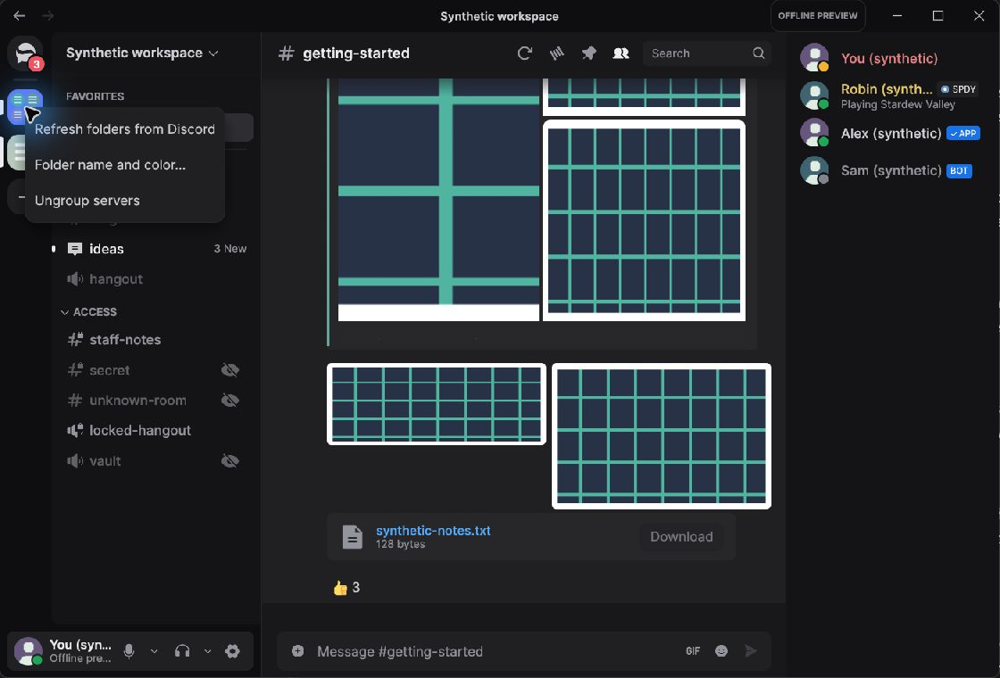
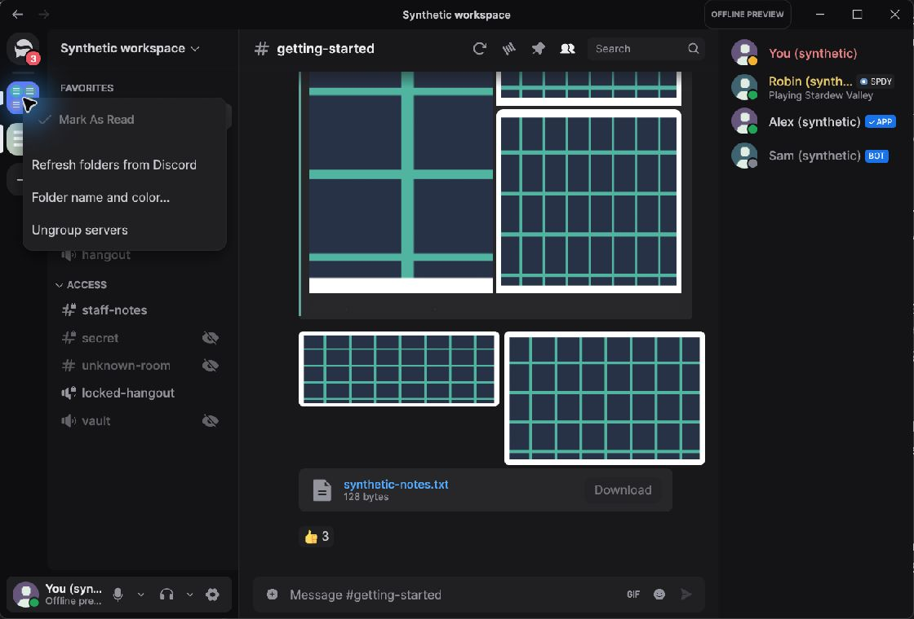

# Server folder mark-as-read — PR #672

These inspected PNGs compare the same synthetic offline workspace and folder context menu before
and after commit `2b02b49e537f77b6db937c6bd6bb05e9f69bb2f3`, using base
`104b1aa5a7f3b3d0771e379ae86f1ae69807de55`. The baseline menu has no “Mark As Read” entry. The
updated menu includes the entry; it is disabled in this fixture because none of the folder's guilds
has unread activity. No live account, Discord transport or user data was used.

| Before | After |
| --- | --- |
|  |  |

Both images are native Windows captures at 1120×760 pixels and 100% display scaling. The same
synthetic `getting-started` channel, folder and app window were used. The screenshots show the
menu's rendered state; they do not claim an enabled-action click against live unread guilds.

## Reproduce the offline build

At each source revision, build and launch only the synthetic demo:

```powershell
cargo build --release --locked -p serein --no-default-features --features demo
& .\target\release\serein.exe --demo
```

Right-click the synthetic server folder in the server rail. At the baseline revision the menu has
no mark-as-read row. At the PR revision the row appears and is disabled for this fixture's read
state. The feature-specific command behavior, eligibility and disconnect/resume behavior are
covered by the eight focused `guild_folders` tests listed in the PR description.

## Runtime and package measurements

[`measurements.json`](measurements.json) contains source revisions, executable hashes, host
details, package-size measurements and all 21 process samples for each demo build. Each process
was measured once after a five-second warmup while the same folder menu was open. Samples were
collected about one second apart for roughly 20 seconds. CPU is the process CPU-seconds delta over
measured wall time, as a percentage of one logical core. Working set and private bytes report the
sample maximum and mean of the final five samples. These two series are descriptive observations,
not evidence of a performance change. Startup latency, frame timing and live Discord behavior were
not measured.

The standard unsigned portable-package comparison used `cargo xtask package` with Rust 1.98.1;
the 216-file installed trees were summed and ZIPs were created with .NET `Compress-Archive`. NSIS
was unavailable, so no installer was produced.
